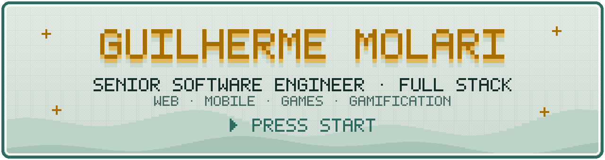
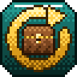
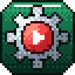
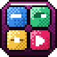
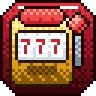
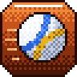
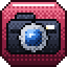
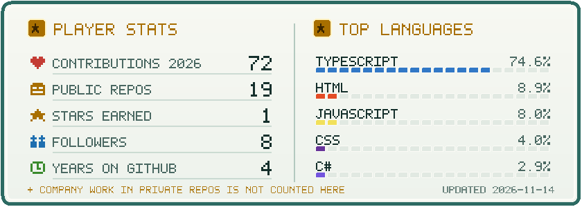

<a href="https://gmolari.vercel.app">
  <picture>
    <source media="(prefers-color-scheme: dark)" srcset="assets/banner-dark.svg">
    
  </picture>
</a>

  
  
  
  

 

<picture>
  <source media="(prefers-color-scheme: dark)" srcset="assets/headers/character-dark.svg">
  
</picture>

| | |
| --- | --- |
| **Class** | Full Stack Engineer |
| **Specialization** | Web, mobile & games |
| **Rank** | Senior · former Tech Lead (team of 5) |
| **HQ** | Londrina, Brazil · 🇧🇷 PT / 🇺🇸 EN |

I build products end to end: web apps, APIs, back offices and mobile apps, from the Figma file to production. Next.js, React and TypeScript on the front, Node, NestJS and .NET on the back, and PixiJS when it has to feel like a game. Lately I also wire AI agents, Claude Code and MCP into the workflow to automate the boring parts.

 

<picture>
  <source media="(prefers-color-scheme: dark)" srcset="assets/headers/skills-dark.svg">
  
</picture>

  

  
  
  
  
  

 

<picture>
  <source media="(prefers-color-scheme: dark)" srcset="assets/headers/quests-dark.svg">
  
</picture>

| Company | Role | Main quest |
| --- | --- | --- |
| **GMaster** | Full Stack Developer | Evolved an internal client management and financial consulting system: REST endpoints in C# and .NET, Next.js screens and architecture. |
| **Ana Gaming** | Tech Lead | Led a team of five front-end and back-end developers: architecture, coding standards, code review and mentoring. |
| **StartBet** | Front-end Engineer | Gamification features, platform solutions, componentization and acquisition flows. |
| **Multibet** | Front-end Engineer | Multi-verso, refer-a-friend back office, popup and minigame admin tools, landing pages. |
| **Supernova Gaming** | Senior Front-end Engineer | Early engineer on Supernova Bet, then took the gamification layer with the team. Built the loop front-end, the back office and the PGX UI library. |

 

<picture>
  <source media="(prefers-color-scheme: dark)" srcset="assets/headers/inventory-dark.svg">
  
</picture>

<table>
  <tr>
    <td align="center" width="33%">
       
      <b>Gamification Loop</b> 🟧 Legendary · front-end 100% solo 
      Missions, levels, rewards and minigames inside an iGaming platform.
    </td>
    <td align="center" width="33%">
       
      <b>Gamification Back Office</b> 🟧 Legendary · built entirely solo 
      Runs the whole loop. 2FA (TOTP), httpOnly sessions, drag-and-drop builders, live previews.
    </td>
    <td align="center" width="33%">
       
      <b>Ad Monetization Engine</b> 🟧 Legendary · solo 
      Decides which ad each player sees. Three casual games on web, Android and iOS run on it.
    </td>
  </tr>
  <tr>
    <td align="center">
       
      <b>PGX UI</b> 🟪 Epic · all the code solo 
      81 React components, API-driven theming and 7 PixiJS minigames, shared by the loop and Supernova Bet.
    </td>
    <td align="center">
       
      <b>Supernova Bet</b> 🟪 Epic · founding front-end 
      Casino, sports and payments with real-time updates.
    </td>
    <td align="center">
       
      <b>Sweepstakes</b> 🟪 Epic · research + prototype 
      Market study and an original casino prototype with a WebGL reel engine.
    </td>
  </tr>
  <tr>
    <td align="center">
       
      <b><a href="https://github.com/gmolari/vortexvolley">VortexVolley</a></b> 🟪 Epic · solo, full stack 
      Expo app + NestJS API + WhatsApp bot to manage a volleyball team.
    </td>
    <td align="center">
       
      <b><a href="https://github.com/gmolari/lp-bigette-fotos-e-videos">Bigette Fotos e Vídeos</a></b> 🟪 Epic · front and back end 
      Next.js 16 landing page with 3D scenes and its own admin back end.
    </td>
    <td align="center">
       
      <b>CityBuilder</b> 🟩 Uncommon · solo 
      City-builder and RTS mod for Minecraft, in Kotlin.
    </td>
  </tr>
</table>

Full details, stacks and the playable character sheet at <a href="https://gmolari.vercel.app">gmolari.vercel.app</a> · source code in <a href="https://github.com/gmolari/gmolari-portfolio">gmolari-portfolio</a>.

 

<picture>
  <source media="(prefers-color-scheme: dark)" srcset="https://raw.githubusercontent.com/gmolari/gmolari/output/stats-dark.svg">
  
</picture>

<picture>
  <source media="(prefers-color-scheme: dark)" srcset="https://raw.githubusercontent.com/gmolari/gmolari/output/snake-dark.svg">
  
</picture>

 

<picture>
  <source media="(prefers-color-scheme: dark)" srcset="assets/headers/party-dark.svg">
  
</picture>

Have a project, a role or a game idea? Send a message on [LinkedIn](https://www.linkedin.com/in/guilherme-molari-5203a8236/) or at **yguilz123@gmail.com**. I usually answer within a day.

▶ PRESS START at <a href="https://gmolari.vercel.app">gmolari.vercel.app</a>

